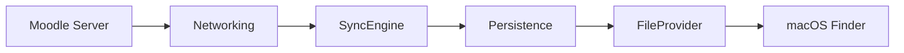

<p align="center">
  
</p>

<h1 align="center">Findle</h1>

<p align="center">
  <b>A native macOS app that syncs Moodle and Open LMS course content directly to your Mac using Apple's File Provider framework.</b>
</p>

<p align="center">
  <a href="https://apple.com/macos"></a>
  <a href="https://swift.org"></a>
  <a href="https://github.com/alexmodrono/Findle/actions"></a>
  <a href="LICENSE"></a>
  <a href="http://makeapullrequest.com"></a>
</p>

<p align="center">
  <em>Your course files right in Finder, behaving exactly like iCloud Drive or Dropbox.</em>
</p>

---

## Overview

Findle brings university and school materials from Moodle into macOS Finder.
It uses SwiftUI for the companion's contents, AppKit for windows and system
integration, and Apple's File Provider framework for on-demand files.

## Finder companion

Findle shows a compact panel beside the active Finder window while you browse
its course location. It displays the current course, its last sync time, and
shortcuts grouped by Moodle sections and activities. The panel fades out during
Finder moves and resizes, then reappears once the window settles. It hides when
you leave the Findle location or switch to another app.

Collapse the panel into a narrow sidebar with SF Symbol controls for syncing,
Moodle, files, and Settings. A small Last synced readout stays visible at the
bottom. The expanded view shows the course hierarchy and a fixed action footer.
On macOS 26 and later, the panel uses the system's Liquid Glass material, with
an opaque background when Reduce Transparency is enabled. Light-gray action
buttons stand apart from the glass. Short hover, press, disclosure, and collapse
transitions provide feedback; Reduce Motion keeps movement to a minimum.

Open Findle from Applications to choose courses and change settings. There is
no menu bar status item or separate course-browser window. First launch uses
the AppKit branch of Airlock, preserving its hello animation and sound without
hiding your other apps.

Finder tracking requires Accessibility permission. The host application is
unsandboxed for this feature; the File Provider extension remains sandboxed.
Sync and Finder files continue to work when companion access is disabled.

## Features

- **Native macOS Experience:** SwiftUI companion contents hosted by AppKit, with a separate Settings window.
- **File Provider Integration:** First-class Finder sidebar presence. Files only download when you actually need them, saving local disk space.
- **Secure by Default:** Authentication happens via the official Moodle Web Services API, and credentials are stored securely in the macOS Keychain.
- **Smart Sync:** The app handles automatic course discovery, enumerates content, and performs incremental syncs using per-course change tracking.
- **Automatic Updates:** Built-in update checking via Sparkle, so you always have the latest version.
- **Efficient Storage:** Under the hood, a local SQLite database caches metadata so you can browse your course structure instantly, using placeholder files until you double-click them.

## Installation

### Download

Download the latest `.dmg` from the [Releases](https://github.com/alexmodrono/Findle/releases/latest) page. Open the disk image and drag Findle to your Applications folder.

### Homebrew

```bash
brew tap alexmodrono/tap
brew install --cask findle
```

## Building from Source

### Requirements

- macOS 15.0 (Sequoia) or later
- Xcode 26.6 for CI/release qualification; newer versions may be used locally
- Swift 6.2 or later
- [XcodeGen 2.44.1](https://github.com/yonaskolb/XcodeGen/releases/tag/2.44.1) (the verified CI generator)

### Steps

Airlock resolves from its [published repository](https://github.com/alexmodrono/Airlock)
at the exact revision recorded in `project.yml`. A sibling checkout is not
required.

The generated project remains ignored, but its shared `Package.resolved` is
versioned so builds use the same remote dependency revisions. Keep changes to
that lockfile with the corresponding `project.yml` dependency update. CI uses
the committed package versions and the verified XcodeGen installer in
`scripts/install-ci-tools.sh`.

1. **Install XcodeGen** (if you haven't already):
   ```bash
   brew install xcodegen
   ```

2. **Generate the Xcode project:**
   ```bash
   xcodegen generate
   ```

3. **Open the project:**
   ```bash
   open Findle.xcodeproj
   ```

4. **Configure Code Signing:**
   The File Provider extension requires code signing with a valid Apple Development Team. Go into the Xcode project settings and select your own Development Team for all targets before building.

5. Select the `Findle` scheme, build, and run.

### Nightly Validation

Before shipping, use the Release-like `Findle-Nightly` scheme. It keeps optimization and hardened runtime behavior close to Release while still allowing tests to run, and produces a separate "Findle Nightly" app that can be installed side-by-side with the production build.

```bash
xcodegen generate
xcodebuild build \
  -project Findle.xcodeproj \
  -scheme Findle-Nightly \
  -configuration Nightly \
  CODE_SIGN_IDENTITY="-" \
  CODE_SIGNING_ALLOWED=NO
```

This builds an unsigned optimized app suitable for fast validation of optimized code paths. It is not suitable for File Provider registration or end-to-end SSO/Finder checks because the extension is not code signed.

For real runtime validation, use the signed Nightly script with your Development
Team configured:

```bash
DEVELOPMENT_TEAM=ABCDE12345 ./scripts/staging-signed-build.sh
```

The script uses the full-history commit count as the development build number.
For dirty or shallow checkouts, or when switching to a branch with a lower
commit count, set `FINDLE_BUILD_NUMBER` to an integer from 1 through 9999 newer
than the installed Nightly. The host, extension and owned frameworks share that
number. A versioned extension update allows macOS to retry previously parked
File Provider errors; verify recovery in the running app. This development
numbering does not replace the release workflow's candidate version/build.

Use the signed Nightly app for the manual checklist: SSO completion, Finder integration, restart/session restore, sync, and file materialization.

The PR Nightly workflow builds an unsigned artifact and puts its download link
in the workflow job summary. It needs no PR write permission or local signing
configuration.

### Onboarding preview

To try the AppKit onboarding without resetting or replacing your installed
Findle or Findle Nightly, run:

```sh
./scripts/onboarding-preview.sh
```

This opens **Findle Onboarding Preview**, a separate sandboxed app. Keep the
sample site (`moodle.example.edu`) and sign in with username `student` and
password `preview`. Try course search and selection, Finder access, and the
first sync. Use **Restart Preview** (Command-R) to start over with fresh data.
The narrow, solid window has a Liquid Glass navigation pill above it. Drag the window's
background to move it, use Command-W to close it, or Command-Option-1 through 9
to select an available step. **Sample Sign-In…** in the app menu shows the test
account details.

The preview compiles the actual setup screens against sample-only state. It
does not store credentials, contact a server, request Accessibility permission,
or register a File Provider domain. It has no App Group or network entitlement
and does not contain the production app lifecycle, persistence, or sync engine.
Institutional SSO and real Finder integration still require separate testing.

For real sign-in, open the signed **Findle Nightly** app and choose **Set Up
Findle…** in its app menu. The current university address is prefilled. Closing
setup keeps the existing session; signing back into the same account refreshes
its credentials while retaining its identity, course selections, and files.
Switching accounts requires signing out explicitly in Settings.

In Xcode, generate the project and select **Findle-OnboardingPreview**. Its test
action covers the shared onboarding flow, finishing with or without sync, empty
course selection, sample validation, cancellation, and fresh preview sessions.

## Architecture

Findle is split into a modular set of frameworks and targets. This keeps the separation of concerns clean and makes it easier to work on isolated features.

| Module | Purpose |
|--------|---------|
| `SharedDomain` | Core types, models, state machines, and shared error handling. |
| `FindleNetworking` | The Moodle API client, authentication logic, and Keychain integration. |
| `FindlePersistence` | The SQLite database layer, metadata cache, and sync cursors. |
| `FindleSyncEngine` | Orchestrates the sync process, computes diffs, and manages downloads. |
| `FindleFileProvider`| The Apple File Provider extension that hooks directly into Finder. |
| `Findle` (App) | The AppKit lifecycle and windows, SwiftUI Finder companion contents, onboarding, diagnostics, and settings. |

### Data Flow Overview


## Testing

Run all seven main test suites using `Cmd+U` with the `Findle` or
`Findle-Nightly` scheme, or generate, build, and test the optimized Nightly
configuration with:

```bash
./scripts/staging-smoke-test.sh
```

The script retains its historical filename but uses the Nightly configuration
and keeps build outputs under `build/`, independent of Xcode's global output
settings. For a focused suite, use a main scheme with `-only-testing`, for
example `-scheme Findle-Nightly -only-testing:PersistenceTests`.

Fast checks and disposable-key release-signing regressions run separately:

```bash
python3 scripts/check-repository.py
python3 -m unittest discover -s Tests/ReleaseToolsTests -v
```

The proposed CI baseline runs repository checks, all main suites in Debug and
Nightly, and the isolated onboarding preview suite. It retains test results
and exposes `CI required` as the aggregate check. Swift formatting is advisory
while its existing baseline is reviewed. CodeRabbit is also advisory; its
configuration does not enable automatic approvals or code changes. Installing
and qualifying the GitHub App, and enabling required checks after the first
successful clean build, remain rollout steps.

CI selects Xcode 26.6 on macOS 26 and checksum-verifies XcodeGen 2.44.1.
Airlock is pinned to a published commit in `project.yml`; the canonical
`Package.resolved` fixes its transitive dependencies. No sibling checkout is needed. Local verification with a newer Xcode does
not replace that runner check. Mock API responses and test fixtures are in
`Fixtures/`. Signed Finder, SSO, and upgrade validation use
`./scripts/staging-signed-build.sh` and the manual checklist above.

### Stability diagnostics

In Settings → Diagnostics, choose **Export Diagnostics…** after reproducing a
failure. The JSON includes the app build and CI revision when available, OS and
channel, database schema/seed state, provider registration, the latest course
outcomes, and up to 128 recent operation events. Attempt IDs connect related
sync/download observations across the app and File Provider. A provider probe
that does not reply within three seconds is reported as timed out; missing or
corrupt storage does not prevent export.

Exports retain error domains and codes, including File Provider errors such as
`-2005`, while omitting error descriptions, server URLs, credentials, account
names and filesystem paths. The local event journal is best effort: it can
skip an event during contention and recover from a torn write. A missing event
is not proof that an operation succeeded.

For a reproduction, record the installation channel and action, retry once,
then export before resetting Finder integration. Keep personal-file recovery
copies until the signed upgrade checks pass. If the app crashes or hangs,
retain its matching macOS crash report or Activity Monitor sample locally;
those system reports can contain personal paths and are not part of the
redacted JSON. Release workflow runs retain matching dSYMs as
`Findle-symbols-<tag>-<run>` artifacts for 90 days. Match the build and binary
UUID before symbolication; an unsigned local test build is not evidence about
a signed release's Finder or SSO behavior.

## Project Structure

```text
Findle/
├── Sources/
│   ├── App/                    # AppKit shell, companion, setup, and settings
│   ├── SharedDomain/           # Shared models and types
│   ├── Networking/             # Moodle API client
│   ├── Persistence/            # SQLite database
│   ├── SyncEngine/             # Sync orchestration
│   └── FileProviderExtension/  # Apple File Provider extension
├── Tests/                      # Unit and integration tests
├── Fixtures/                   # Mock API response data
├── Resources/                  # Plists, entitlements, and XCAssets
└── project.yml                 # XcodeGen project definition
```

## Roadmap

There's still a lot to be done. Here is what is currently on the radar:

- [x] Complete the end-to-end vertical slice (authenticate -> enumerate -> Finder placeholders)
- [x] Background sync refresh
- [x] Offline pinning support
- [ ] Multi-account support
- [ ] Optional offline mirror to a user-chosen folder
- [x] Spotlight integration
- [ ] Assignment submission support directly from the Mac
- [ ] Support for additional LMS backends

## Contributing

Contributions are always welcome! If you have an idea to improve Findle or fix a bug:

1. Fork the repository
2. Create your feature branch (`git checkout -b feature/AmazingFeature`)
3. Commit your changes (`git commit -m 'Add some AmazingFeature'`)
4. Push to the branch (`git push origin feature/AmazingFeature`)
5. Open a Pull Request for review.

## License

This project is licensed under the Apache License 2.0. See the [LICENSE](LICENSE) file for the full details.

## Project board

The shared task board is `kanvas.json`. Start Kanvas with:

```sh
python3 .agents/skills/kanvas/kanvas.py serve
```

Agent instructions are in [AGENTS.md](AGENTS.md). The bundled Kanvas files are
versioned with the board; other locally installed skills stay local.
